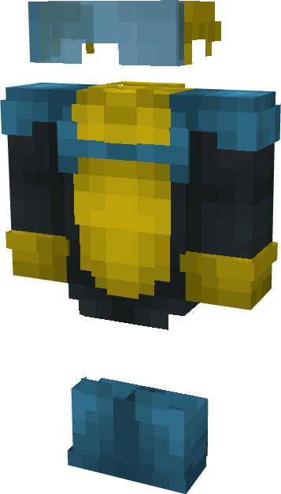

# Invincible (Terra)

{ width="177" height="310" loading=lazy }

**"Invincible (Terra) Suit"** is obtained via:

* x4 Blue Basic Fabrics
* x4 Yellow Basic Fabrics
* x2 Light Blue Stained Glass Pane
* Iron Armor Set

in a Tailoring Bench and can be repaired via "Reinforced Fabric Repair Kits".

**Stats**:

* Armor Rating: 20
* Armor Toughness: 4
