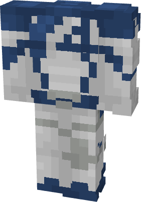

# Invisible Woman (Rivals)

{ width=170 height=244 loading=lazy }

**"Invisible Woman (Rivals) Suit"** is obtained via transforming Fantastic Four suit variants inside **Multiversal Iterator** with **"Earth-TRN1445"** Multiversal Extrapolator and can be repaired via "Tri-Polymer Fabric Repair Kits".

**Stats**:

* Armor Rating: 18
* Armor Toughness: 6
