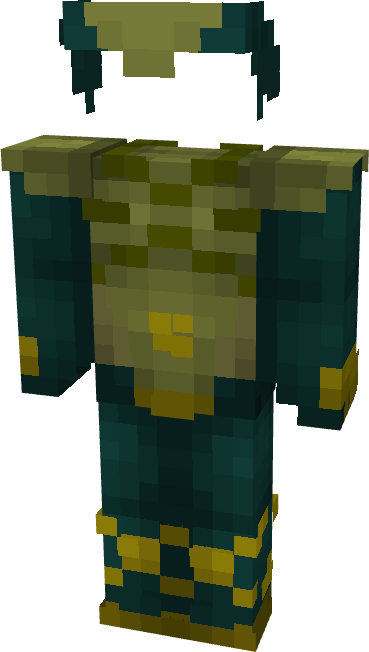

# Jean Grey

{ width=191 height=336 loading=lazy }

**"Jean Grey Suit"** is obtained via:

* x4 Green Basic Fabrics
* x4 Lime Basic Fabrics
* x2 Yellow Basic Fabrics
* Leather Armor Set

in a Tailoring Bench and can be repaired via "Basic Fabric Repair Kits".

**Stats**:

* Armor Rating: 18
* Armor Toughness: N / A
