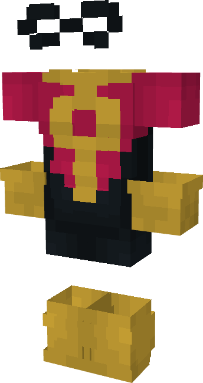

# Kid Omniman (Young)

{ width=159 height=299 loading=lazy }

**"Kid Omniman (Young) Suit"** is obtained via:

* x4 Black Basic Fabrics
* x4 Red Basic Fabrics
* x2 Yellow Basic Fabrics
* Leather Armor Set

in a Tailoring Bench and can be repaired via "Basic Fabric Repair Kits".

**Stats**:

* Armor Rating: 18
* Armor Toughness: N / A
