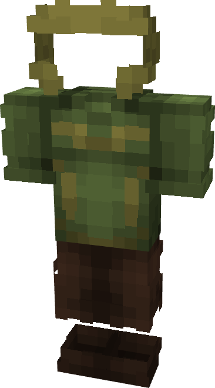

# Loki (God of Stories)

{ width=210 height=377 loading=lazy }

**"Loki (God of Stories) Suit"** is obtained via:

* x4 Green Basic Fabrics
* x4 Brown Blue Basic Fabrics
* x1 Uru Template
* Iron Armor Set

in a Tailoring Bench and can be repaired via "[Uru Ingot](../../blocks/ores/uru.md)".

**Stats**:

* Armor Rating: 22
* Armor Toughness: 8
