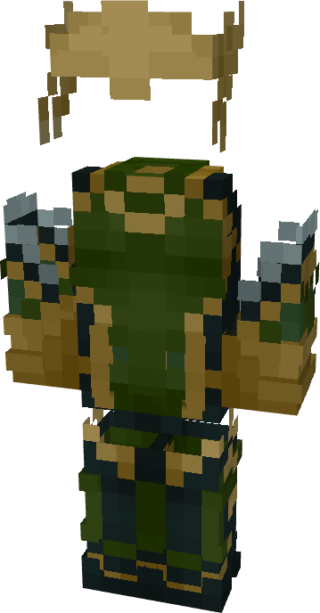

# Lady Loki (Rivals)

{ width=205 height=391 loading=lazy }

**"Lady Loki (Rivals) Suit"** is obtained via transforming Loki (God of Stories) Armorset inside **Multiversal Iterator** with **"Earth-TRN1445"** Multiversal Extrapolator and can be repaired via "[Uru Ingot](../../blocks/ores/uru.md)".

**Stats**:

* Armor Rating: 22
* Armor Toughness: 8
