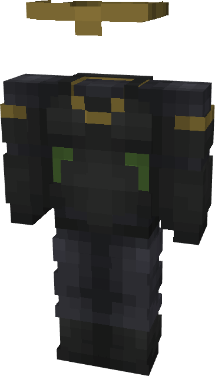

# Loki (Sylvie)

{ width="135" height="234" loading=lazy }

**"Loki (Sylvie) Suit"** is obtained via transforming Loki (God of Stories) Armorset inside **Multiversal Iterator** with **"Earth-L0852"** Multiversal Extrapolator and can be repaired with "[Uru Ingots](../../blocks/ores/uru.md)".

**Stats**:

* Armor Rating: 23
* Armor Toughness: 8
