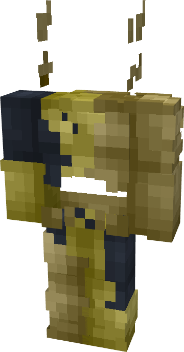

# Magik

{ width=198 height=377 loading=lazy }

**"Magik Suit"** is obtained via:

* x4 Black Reinforced Fabrics
* x4 Yellow Reinforced Fabrics
* x4 Gold Ingot
* Iron Armor Set

in a Tailoring Bench and can be repaired via "Reinforced Fabric Repair Kits".

**Stats**:

* Armor Rating: 20
* Armor Toughness: 4
