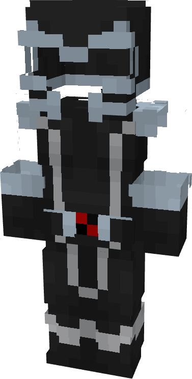

# Magneto (Black)

{ width="188" height="370" loading=lazy }

**"Magneto (Black) Suit"** is obtained via:

* x4 Black Reinforced Fabrics
* x4 Light Gray Reinforced Fabrics 
* Magneto (Red) Armor Set

in a Tailoring Bench and can be repaired via "Reinforced Fabric Repair Kits".

For **Magneto (Black) Helmet:**

* x1 Black Tri-Polymer Fabric

* x1 Gray Tri-Polymer Fabric
* x1 Magneto (Base) Helmet

in a crafting table and can be reparied with Netherite Ingots in an anvil.

**Stats**:

* Armor Rating: 20
* Armor Toughness: 6

**Additional Information**: Magneto Helmet protects the user from Telephatic Attacks.
