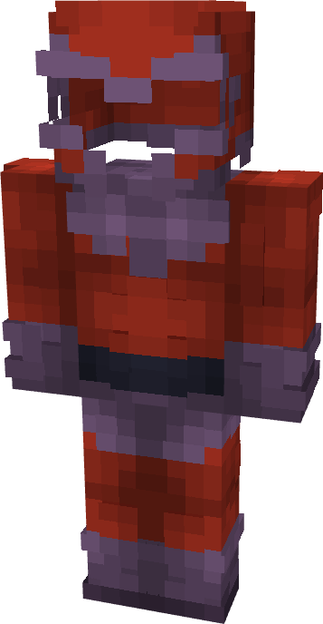

# Magneto (Red)

{ width=183 height=351 loading=lazy }

**"Magento (Red) Suit"** is obtained via:

* x4 Purple Basic Fabrics
* x4 Red Basic Fabrics
* x4 Red Basic Fabrics
* Leather Armor Set

in a Tailoring Bench and can be repaired via "Basic Fabric Repair Kits".

For **Magneto (Base) Helmet:**

* x1 Red Tri-Polymer Fabric
* x1 Purple Tri-Polymer Fabric
* x1 Magneto (Base) Helmet

in a crafting table and can be reparied with Netherite Ingots in an anvil.

**Stats**:

* Armor Rating: 18
* Armor Toughness: 3

**Additional Information**: Magneto Helmet protects the user from Telephatic Attacks.
