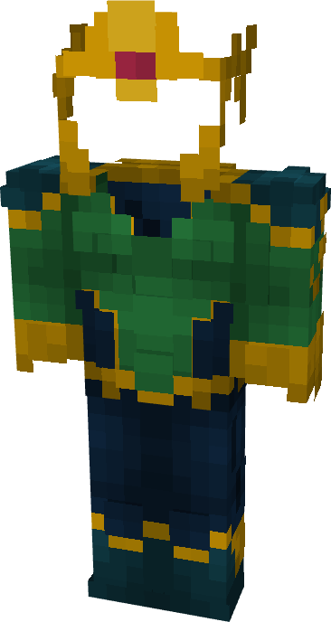

# Mera

{ width=209 height=391 loading=lazy }

**"Mera Suit"** is obtained via:

* x4 Blue Basic Fabrics
* x4 Green Basic Fabrics
* x1 Nth Metal Template
* Diamond Armor Set

in a Tailoring Bench and can be repaired via "[Reinforced Fabric Repair Kits](../../blocks/ores/nth-metal.md)".

**Stats**:

* Armor Rating: 22
* Armor Toughness: 8
