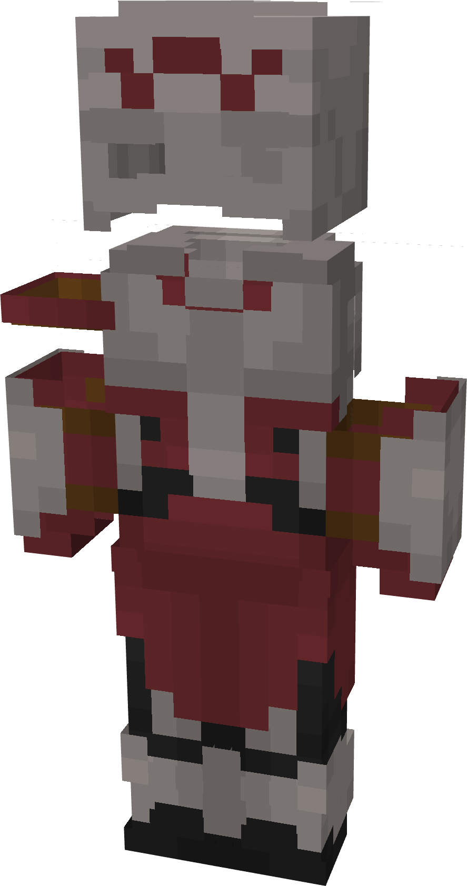

# Mighty Thor

{ width="200" height="378" loading=lazy }

**"Mighty Thor Suit"** is obtained via:

* x4 Grey Basic Fabrics
* x4 Light Grey Basic Fabrics
* x2 Black Basic Fabrics
* x2 Brown Basic Fabrics
* x1 Uru Template
* Diamond Armor Set

in a Tailoring Bench and can be repaired via "Reinforced Fabric Repair Kits".

**Stats**:

* Armor Rating: 20
* Armor Toughness: 4
