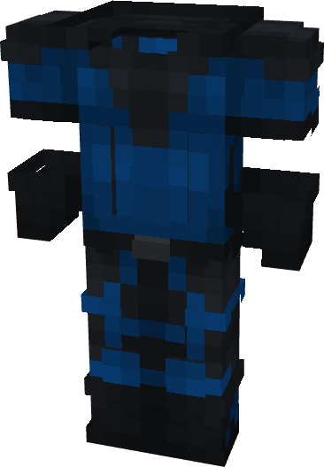

# M.I.N.E. Labs

{ width=248 height=357 loading=lazy }

**"M.I.N.E. Labs Suit"** is obtained via:

* x2 Blue Reinforced Fabrics
* x2 Black Reinforced Fabrics
* x2 White Reinforced Fabrics
* Leather Armor Set

in a Tailoring Bench and can be repaired via "[Reinforced Fabric Repair Kits](../../blocks/ores/nth-metal.md)".

**Stats**:

* Armor Rating: 17
* Armor Toughness: 3
