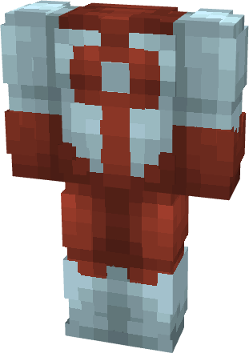

# Omniman (Original)

{ width=234 height=331 loading=lazy }

**"Omniman (Original) Suit"** is obtained via:

* x4 Red Reinforced Fabrics
* x4 White Reinforced Fabrics
* Iron Armor Set

in a Tailoring Bench and can be repaired via "Reinforced Fabric Repair Kits".

**Stats**:

* Armor Rating: 17
* Armor Toughness: 3
