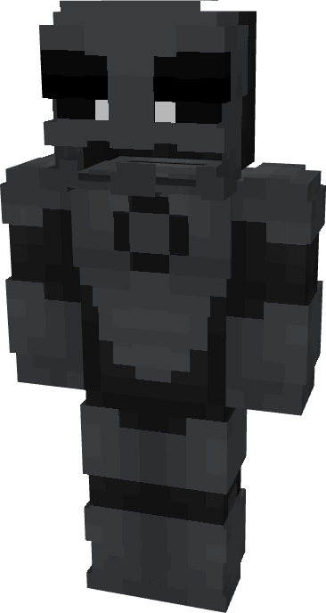

# Owlman

{ width=194 height=363 loading=lazy }

**"Owlman Suit"** is obtained via transforming Batman Armorset inside **Multiversal Iterator** with **"Earth-3"** Multiversal Extrapolator and can be repaired via "Reinforced Fabric Repair Kits".

**Stats**:

* Armor Rating: 20
* Armor Toughness: 4
