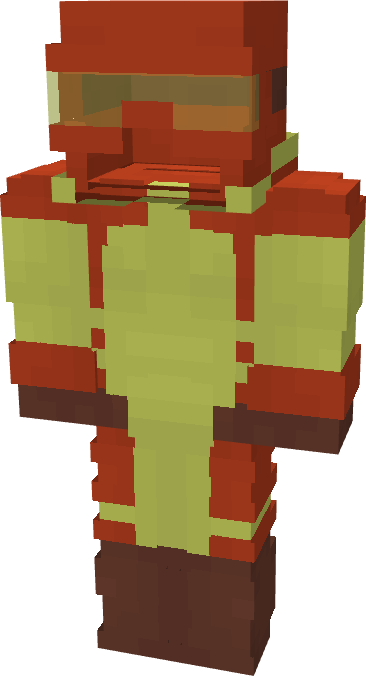

# Rexplode

{ width="173" height="319" loading=lazy }

**"Rexplode Suit"** is obtained via:

* x4 Red Basic Fabrics
* x4 Yellow Basic Fabrics
* x2 Brown Basic Fabrics
* Leather Armor Set

in a Tailoring Bench and can be repaired via "Basic Fabric Repair Kits".

**Stats**:

* Armor Rating: 18
* Armor Toughness: N / A
