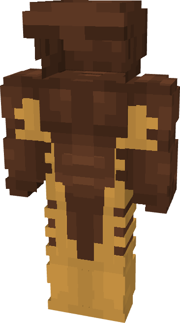

# Sabretooth

{ width=200 height=357 loading=lazy }

**"Sabretooth Suit"** is obtained via:

* x4 Brown Basic Fabrics
* x6 Yellow Basic Fabrics
* Leather Armor Set

in a Tailoring Bench and can be repaired via "Basic Fabric Repair Kits".

**Stats**:

* Armor Rating: 18
* Armor Toughness: N / A
