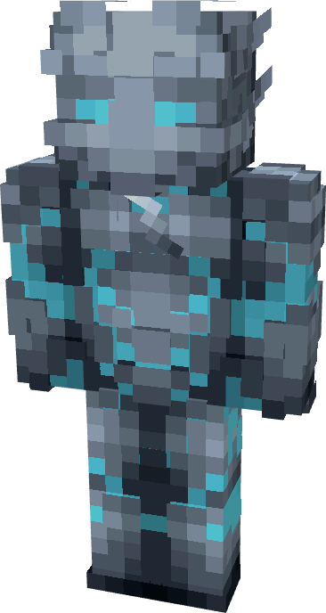

# Savitar (CW)

{ width=218 height=408 loading=lazy }

**"Savitar (CW) Suit"** is obtained via:

* x4 Titanium Circuit
* x4 Diamond Circuit
* Flash (Classic) Armor Set

in a Tailoring Bench and can be repaired via "Tri-Polymer Fabric Repair Kits".

**Stats**:

* Armor Rating: 22
* Armor Toughness: 8

**Additional Information:**

* This suit will increase your height.
* Wearing this suit with a [Speedforce ](../../powers/main-powers/speedforce/index.md)power, the suit's glowing part will adapt to your speedforce color.
* This suit has a toggleable blade built in, with open equipment keybind. This blade will increase your attack damage by +3. 
