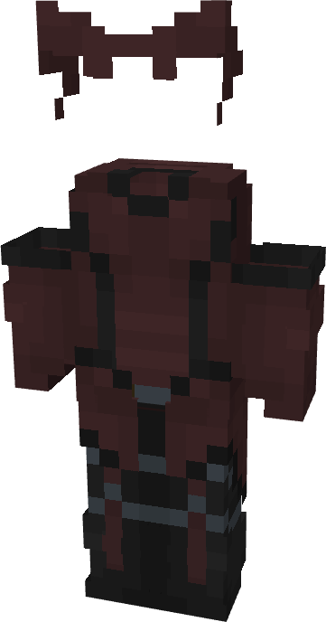

# Scarlet Witch (MCU)

{ width=209 height=398 loading=lazy }

**"Scarlet Witch (MCU) Suit"** is obtained via:

* x4 Black Reinforced Fabrics
* x4 Red Reinforced Fabrics
* Iron Armor Set

in a Tailoring Bench and can be repaired via "Reinforced Fabric Repair Kits".

**Stats**:

* Armor Rating: 20
* Armor Toughness: 4
