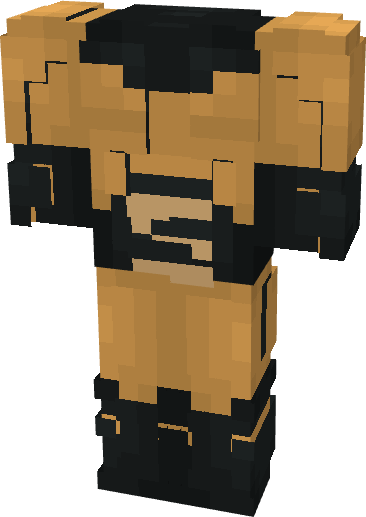

# Sentry (Thunderbolts)

{ width=241 height=340 loading=lazy }

**"Sentry (Thunderbolts) Suit"** is obtained via transforming Sentry (Classic) Armorset inside **Multiversal Iterator** with **"Earth-199999"** Multiversal Extrapolator and can be repaired via "Basic Fabric Repair Kits".

**Stats**:

* Armor Rating: 15
* Armor Toughness: N / A
