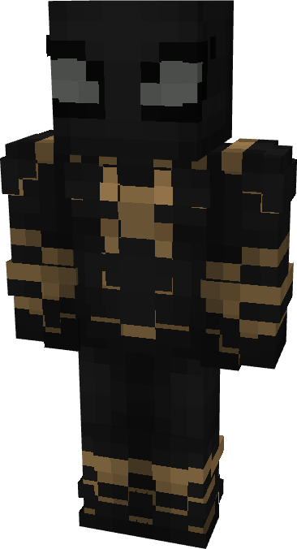

# Spider-Man (Far From Home - Inverted)

{ width=213 height=393 loading=lazy }

**"Spider-Man (Far From Home - Inverted) Suit"** is obtained via:

* x2 Black Basic Fabrics
* Spider-Man (Far From Home) Armor Set

in a Tailoring Bench and can be repaired via "Reinforced Fabric Repair Kits".

* Armor Rating: 20
* Armor Toughness: 4
