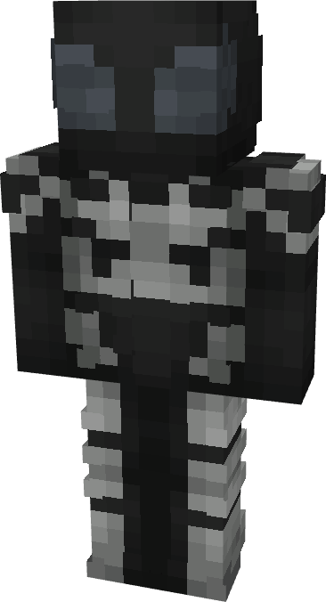

# Spider-Man (Future Foundation - Stealth)

{ width=217 height=400 loading=lazy }

**"Spider-Man (Future Foundation - Stealth) Suit"** is obtained via:

* x4 Black Tri-Polymer Fabrics
* x4 White Tri-Polymer Fabrics
* x4 Diamond Circuit
* Spider-Man (Homecoming) Armor Set

in a Tailoring Bench and can be repaired via "Tri-Polymer Fabric Repair Kits".

* Armor Rating: 22
* Armor Toughness: 8
