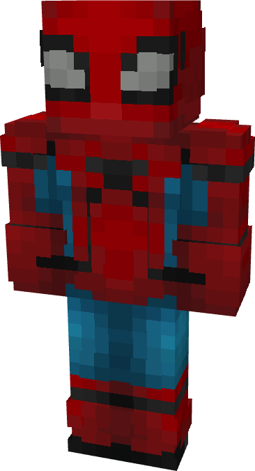

# Spider-Man (Homecoming)

{ width=196 height=361 loading=lazy }

**"Spider-Man (Homecoming) Suit"** is obtained via:

* x4 Blue Reinforced Fabrics
* x4 Red Reinforced Fabrics
* x2 Iron Circuit
* Spider-Man (Homemade) Armor Set

in a Tailoring Bench and can be repaired via "Reinforced Fabric Repair Kits".

**Stats**:

* Armor Rating: 20
* Armor Toughness: 4
