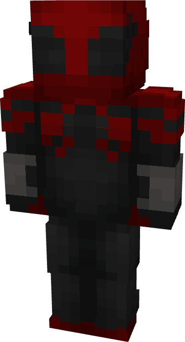

# Spider-Man (Superior)

{ width=220 height=406 loading=lazy }

**"Spider-Man (Superior) Suit"** is obtained via:

* x4 Black Tri-Polymer Fabrics
* x4 Red Tri-Polymer Fabrics
* x2 Iron Circuit
* Spider-Man (Homecoming) Armor Set

and can be repaired via "Tri-Polymer Fabric Repair Kits".

**Stats:**

* Armor Rating: 22
* Armor Toughness: 8
