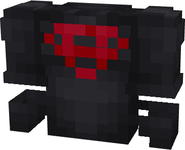
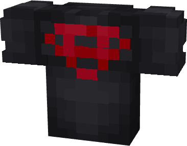

# Superboy (Young Justice)

{ width=318 height=257 loading=lazy }{ width=316 height=246 loading=lazy }

**"Superboy (Young Justice) Chestplate and Shirt"** is obtained via transforming Superboy Chestplate(YJ chestplate for getting the shirt) inside **Multiversal Iterator** with **"Earth-16"** Multiversal Extrapolator and can be repaired via "Basic Fabric Repair Kits".

**Stats:**

* Armor Rating: 7
* Armor Toughness: N / A
