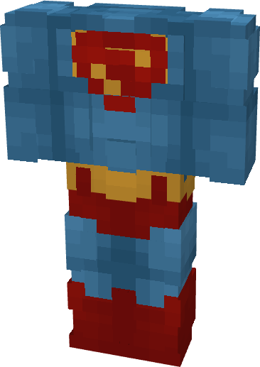

# Supergirl (DCU)

{ width=228 height=322 loading=lazy }

**"Supergirl (DCU) Suit"** is obtained via transforming Supergirl (Rebirth) inside **Multiversal Iterator** with **"Earth-(0001-R)"** Multiversal Extrapolator and can be repaired via "Reinforced Fabric Repair Kits".

**Stats:**

* Armor Rating: 17
* Armor Toughness: 3
