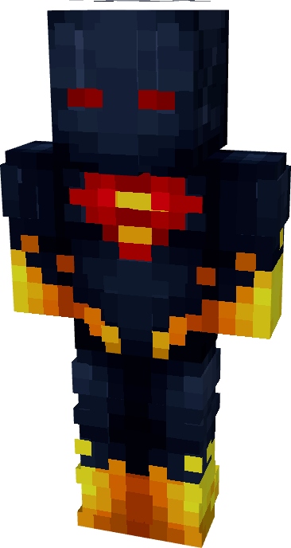

# Superman (Absolute)

{ width=211 height=395 loading=lazy }

**"Superman (Absolute)** via transforming Superman Armorset inside **Multiversal Iterator** with **"Elseworlds"** Multiversal Extrapolator and can be repaired via "Tri-Polymer Fabric Repair Kits".

**Stats:**

* Armor Rating: 22
* Armor Toughness: 8

**Additional Information:**

* This suit's helmet can be toggle on / off with "**Open Equipment**" keybind.
* If you use this suit with a[ Full Kryptonian](../../powers/main-powers/kryptonians-full/index.md) it will glow when you have solar energy.
