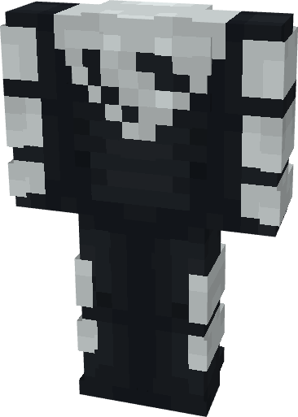

# Superman (Beyond)

{ width=222 height=311 loading=lazy }

**"Superman (Beyond)** via transforming Superman Armorset inside **Multiversal Iterator** with **"Earth-12"** Multiversal Extrapolator and can be repaired via "Tri-Polymer Fabric Repair Kits".

**Stats:**

* Armor Rating: 18
* Armor Toughness: 6
