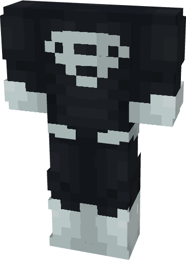

# Superman (Black)

{ width=240 height=335 loading=lazy }

**"Superman (Black)** is obtained via:

* x4 Black Tri-Polymer Fabrics
* x4 Light Gray Tri-Polymer Fabrics
* x2 Netherite Circuit
* Superman (Classic) Armor Set

and can be repaired via "Tri-Polymer Fabric Repair Kits".

**Stats:**

* Armor Rating: 18
* Armor Toughness: 6

**Additional Information:** This suit will increase the solar gain on [Full Kryptonians](../../powers/main-powers/kryptonians-full/index.md).
