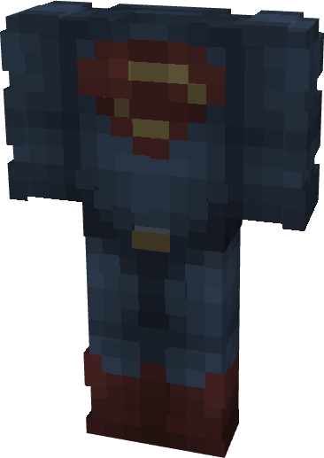

# Superman (DCEU)

{ width=233 height=328 loading=lazy }

**"Superman (DCEU)** is obtained via transforming Superman Armorset inside **Multiversal Iterator** with **"Earth-2149"** Multiversal Extrapolator and can be repaired via "Reinforced Fabric Repair Kits".

**Stats:**

* Armor Rating: 17
* Armor Toughness: 3
