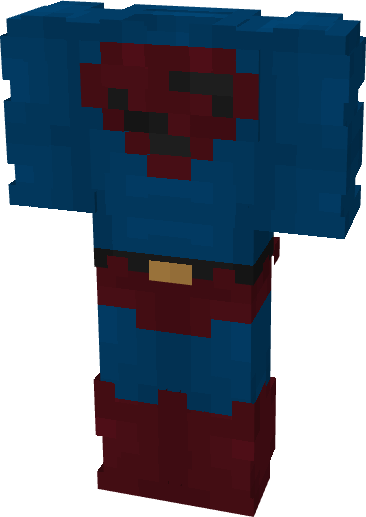

# Superman (Kingdom Come)

{ width=215 height=303 loading=lazy }

**"Superman (Kingdom Come)** is obtained via transforming Superman Armorset inside **Multiversal Iterator** with **"Elseworlds"** Multiversal Extrapolator and can be repaired via "Reinforced Fabric Repair Kits".

**Stats:**

* Armor Rating: 17
* Armor Toughness: 3
