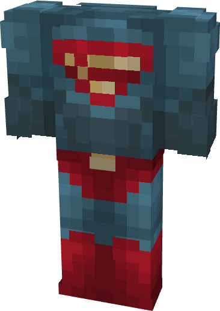

# Superman (MAWS)

{ width="228" height="322" loading=lazy }

**"Superman (MAWS)** is obtained via transforming Superman Armorset inside **Multiversal Iterator** with **"Earth-12"** Multiversal Extrapolator and can be repaired via "Tri-Polymer Fabric Repair Kits".

**Stats:**

* Armor Rating: 18
* Armor Toughness: 6
