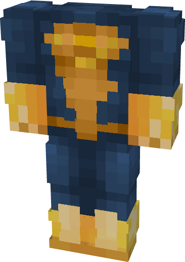

# Superman (Shazam)

{ width=271 height=382 loading=lazy }

**"Superman (Shazam)** is obtained via:

* x4 Yellow Basic Fabrics
* x4 Blue Basic Fabrics
* Superman (Classic) Armor Set

in a Tailoring Bench and can be repaired via "Tri-Polymer Fabric Repair Kits".

**Stats:**

* Armor Rating: 18
* Armor Toughness: 6
