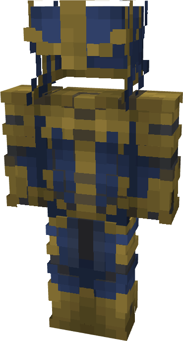

# Thanos (MCU)

{ width=187 height=348 loading=lazy }

**"Thanos (MCU)** is obtained via:

* x4 Blue Reinforced Fabrics
* x12 Gold Ingot
* Diamond Armor Set

in a Tailoring Bench and can be repaired via "Tri-Polymer Fabric Repair Kits".

**Stats:**

* Armor Rating: 22
* Armor Toughness: 8
