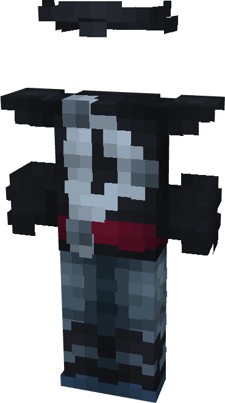

# Thor (Cosmic)

{ width=220 height=394 loading=lazy }

**"Thor (Cosmic)** is obtained via:

* x4 Black Tri-Polymer Fabrics
* x4 White Tri-Polymer Fabrics
* x1 Uru Template
* Diamond Armor Set

in a Tailoring Bench and can be repaired via "[Uru Ingot](../../blocks/ores/uru.md)".

**Stats:**

* Armor Rating: 22
* Armor Toughness: 8
