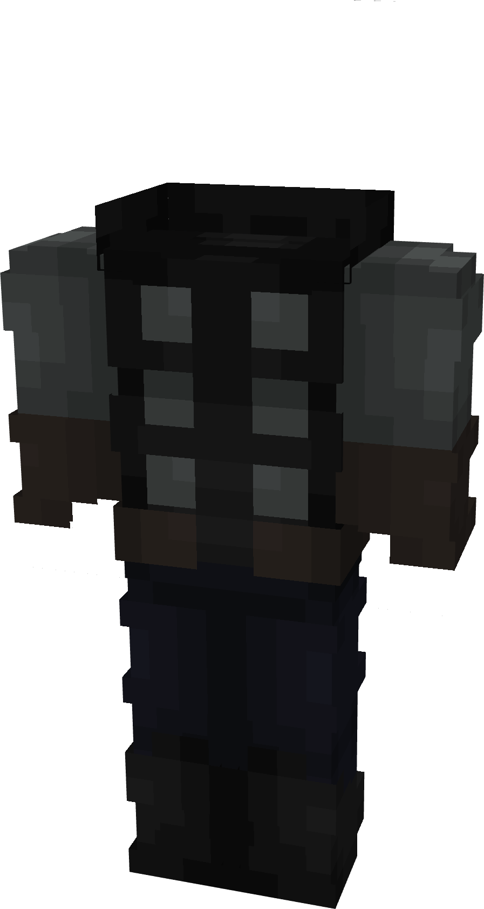

# Thor (Infinity War)

{ width="200" height="374" loading=lazy }

**"Thor (Infinity War) Suit"** is obtained via:

* x4 Gray Tri-Polymer Fabrics
* x4 Black Tri-Polymer Fabrics
* x1 Uru Template
* Diamond Armor Set 

in a Tailoring Bench and can be repaired with "[Uru Ingots](../../blocks/ores/uru.md)".

**Stats**:

* Armor Rating: 18
* Armor Toughness: 6
