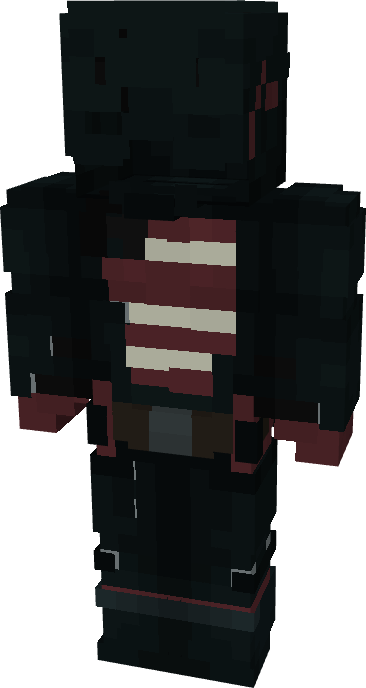

# U.S. Agent (MCU)

{ width=210 height=393 loading=lazy }

**"U.S. Agent (MCU)"** is obtained is obtained via transforming U.S. Agent (Comics) Armorset inside **Multiversal Iterator** with **"Earth-199999"** Multiversal Extrapolator and can be repaired via "Reinforced Fabric Repair Kits".

**Stats:**

* Armor Rating: 20
* Armor Toughness: 4
