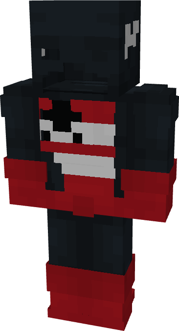

# U.S. Agent

{ width=188 height=347 loading=lazy }

**"U.S. Agent"** is obtained via:

* x4 Black Basic Fabrics
* x4 Red Basic Fabrics
* Leather Armor Set

in a Tailoring Bench and can be repaired via "Basic Fabric Repair Kits".

**Stats:**

* Armor Rating: 18
* Armor Toughness: N / A
