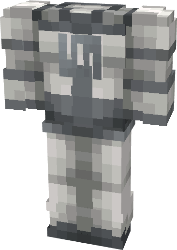

# Viltrumite (Captain)

{ width=170 height=240 loading=lazy }

**"Viltrumite (Captain) Suit"** is obtained via:

* x4 White Reinforced Fabrics
* x4 Gray Reinforced Fabrics
* Iron Armor Set

in a Tailoring Bench and can be repaired via "Reinforced Fabric Repair Kits".

**Stats**:

* Armor Rating: 17
* Armor Toughness: 3
