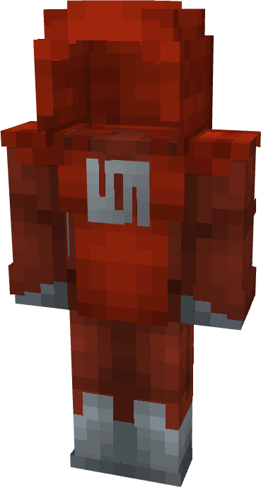

# Viltrumite (Royal Guard)

{ width=218 height=406 loading=lazy }

**"Viltrumite (Royal Guard) Suit"** is obtained via:

* x6 Red Reinforced Fabrics
* x2 Light Gray Reinforced Fabrics
* Iron Armor Set

in a Tailoring Bench and can be repaired via "Reinforced Fabric Repair Kits".

**Stats**:

* Armor Rating: 17
* Armor Toughness: 3
