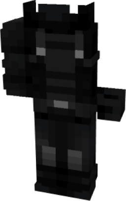

# Winter Soldier (MCU)

{ width="196" height="372" loading=lazy }

**"Winter Soldier (MCU) Suit"** is obtained via:

* x4 Black Basic Fabrics
* x4 Gray Basic Fabrics
* Leather Armor Set

in a Tailoring Bench and can be repaired via "Basic Fabric Repair Kits".

**Stats**:

* Armor Rating: 18
