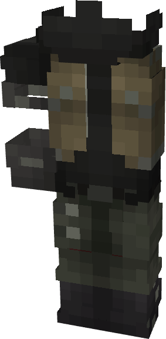

# Winter Soldier (Rivals)

{ width="172" height="350" loading=lazy }

**"Winter Soldier (Rivals) Suit"** is obtained is obtained via transforming Winter Soldier (MCU) Armorset inside **Multiversal Iterator** with **"Earth-TRN1445"** Multiversal Extrapolator and can be repaired via "Basic Fabric Repair Kits".

**Stats**:

* Armor Rating: 18
* Armor Toughness: N / A
