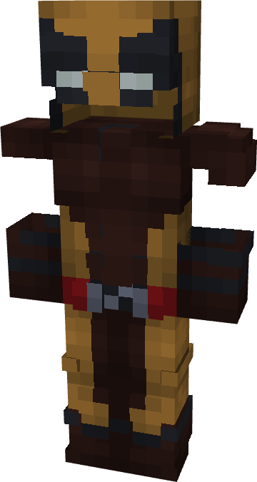

# Wolverine (Brown)

{ width=170 height=318 loading=lazy }

**"Wolverine (Brown) Suit"** is obtained via:

* x4 Yellow Basic Fabrics
* x4 Brown Basic Fabrics
* x2 Red Basic Fabrics
* x2 Black Basic Fabrics
* Leather Armor Set

in a Tailoring Bench and can be repaired via "Reinforced Fabric Repair Kits".

**Stats**:

* Armor Rating: 20
* Armor Toughness: 4
