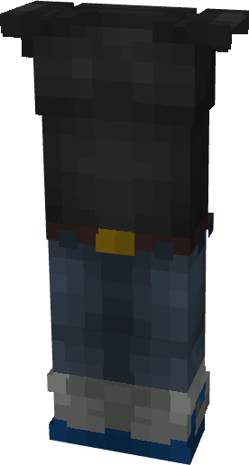

# Wolverine (Rivals)

{ width=173 height=323 loading=lazy }

**"Wolverine (Rivals) Suit"** is obtained is obtained via transforming Wolverine Armorset inside **Multiversal Iterator** with **"Earth-TRN1445"** Multiversal Extrapolator and can be repaired via "Basic Fabric Repair Kits".

**Stats**:

* Armor Rating: 15
* Armor Toughness: N / A
