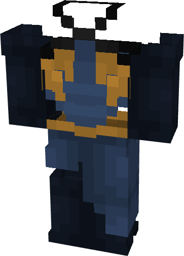

# Wolverine (X-23 Hellfire Gala)

{ width=231 height=320 loading=lazy }

**"Wolverine (X-23 Hellfire Gala) Suit"** is obtained via:

* x4 Blue Basic Fabrics
* x4 Yellow Basic Fabrics
* x2 Black Basic Fabrics
* Leather Armor Set

and can be repaired via "Basic Fabric Repair Kits".

**Stats**:

* Armor Rating: 15
* Armor Toughness: N / A
