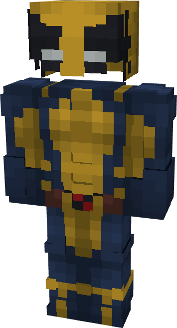

# Wolverine (X-23)

{ width=172 height=317 loading=lazy }

**"Wolverine (X-23) Suit"** is obtained via:

* x4 Blue Basic Fabrics
* x4 Yellow Basic Fabrics
* x2 Red Basic Fabrics
* x2 Brown Basic Fabrics
* Leather Set

in a Tailoring Bench and can be repaired via "Basic Fabric Repair Kits".

**Stats**:

* Armor Rating: 18
