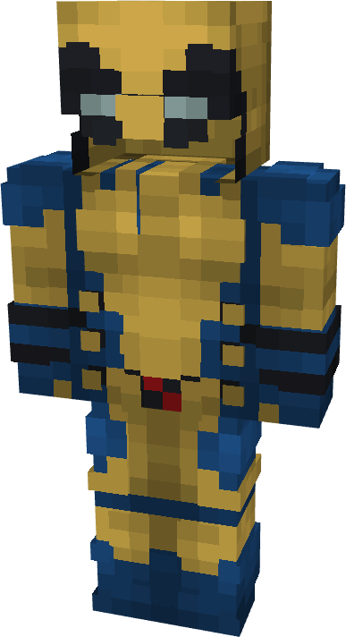
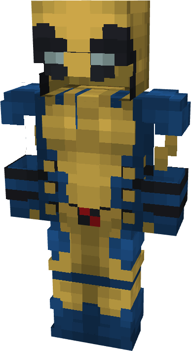

# Wolverine

{ width="178" height="326" loading=lazy }{ width="179" height="328" loading=lazy }

**"Wolverine Suit"** is obtained via:

* x2 Black Basic Fabrics
* x4 Yellow Basic Fabrics
* x4 Blue Basic Fabrics
* x2 Red Basic Fabrics
* Leather Armor Set

in a Tailoring Bench and can be repaired via "Basic Fabric Repair Kits". This armors chestplate can be put in a crafting table with Shears, to make the **"Sleeveless"** variant of the suit

**Stats**:

* Armor Rating: 18
* Armor Toughness: N / A
