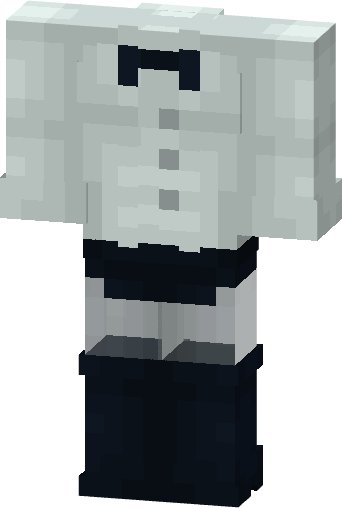

# Zatanna (Brave and the Bold)

{ width="189" height="280" loading=lazy }

**"Zatanna (B&TB) Suit"** is obtained via:

* x8 Black Basic Fabrics
* x10 White Basic Fabrics
* Leather Armor set

In a Tailoring Bench and can be repaired via "Basic Fabric Repair Kits".

**Stats**:

* Armor Rating: 15
* Armor Toughness: N / A
