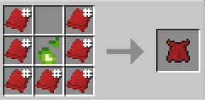

# Hellspawn Cape

{ width=100 height=100 loading=lazy }

**Hellspawn Cape** can be obtained via crafting with x7 Red Basic Fabric and x1 Hellfire Soul inside a crafting table.

{ width=266 height=131 loading=lazy }

Uses:

Using this cape while having [Hellspawn](../../../powers/main-powers/hell-spawn.md) will grant you ender storage ability.

Using without Hellspawn its just a regular cape.
