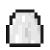
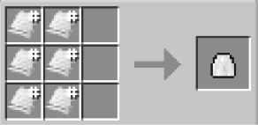
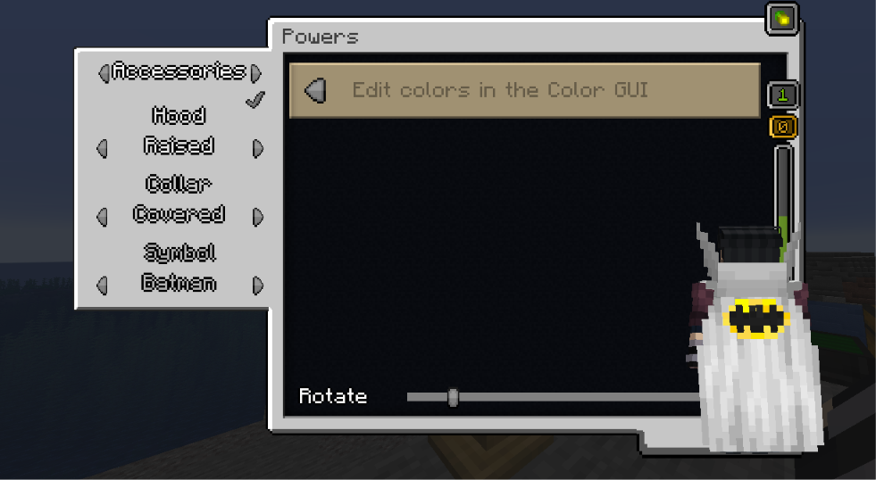

# Heroic Cape

{ width=100 height=100 loading=lazy }

**Heroic Cape** can be obtained via crafting with x6 Any Color [Basic Fabric ](../../../items/technology/fabrics/basic-fabric.md)inside a crafting table.

{ width=219 height=107 loading=lazy }

Uses:

Using a [Glide Module](../../../items/technology/glide-module.md) you can glide with this cape.

You can adjust Primary / Secondary  Colors and Accessories in power menu:

{ width=736 height=404 loading=lazy }
